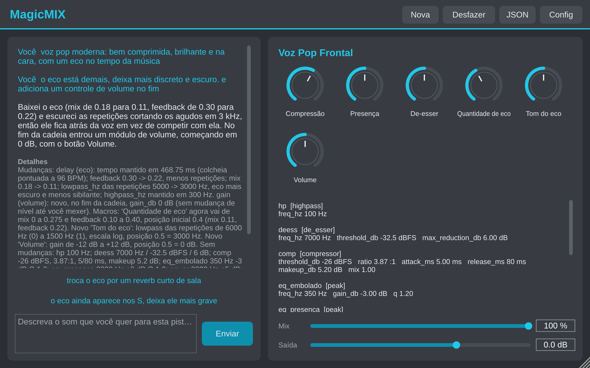

# MagicMIX: plugin VST3 / AU / app

Você descreve em texto o som que quer para a pista ("voz mais na cara e com brilho", "bumbo com mais
peso, sem estourar") e o MagicMIX monta uma cadeia de efeitos com botões prontos para ajustar.

A IA só interpreta o pedido e escolhe os efeitos. **O áudio não sai do computador** e é processado por
efeitos próprios do plugin, em tempo real.



## Instalar

**Mac** (Apple Silicon ou Intel, macOS 11 ou mais novo): dê dois cliques em `MagicMIX-x.y-macOS.pkg`.
É um instalador só, que serve para os dois tipos de Mac.
**Windows** (10/11, 64 bits): dê dois cliques em `MagicMIX-x.y-Windows-Setup.exe`.

| Componente | macOS | Windows |
|---|---|---|
| Plugin VST3 (REAPER, Ableton Live, Cubase, Studio One...) | sim | sim |
| Plugin AU (Logic, MainStage, GarageBand) | sim | não existe AU no Windows |
| App sem DAW (usa a entrada da placa de som) | sim | sim |

Depois peça ao seu programa para **procurar plugins de novo**.

> **Enquanto o instalador não for assinado pela Apple/Microsoft:**
> - macOS: se aparecer "não pode ser aberto porque é de um desenvolvedor não identificado",
>   abra Ajustes do Sistema > Privacidade e Segurança e clique em **Abrir Mesmo Assim**.
> - Windows: se aparecer "O Windows protegeu o computador", clique em **Mais informações** >
>   **Executar assim mesmo**.

## Primeiro uso

1. Clique em **Config** e informe a sua **chave da API** da Anthropic. Ela fica guardada só neste
   computador, fora do projeto da DAW.
2. Coloque o MagicMIX na pista e **dê play**, para o plugin ouvir o som.
3. Escreva o pedido e clique em **Enviar**.

## Como usar

- **Conversa**: cada pedido novo ajusta a cadeia que já existe ("menos eco", "agora mais grave").
  Para começar do zero, clique em **Nova**.
- **Sugestões**: depois de cada resposta aparecem próximos pedidos prontos para clicar. Se você não
  sabe o que quer, peça ideias ("me dá sugestões para esse teclado").
- **Botões**: cada cadeia vem com até 10 botões com nome próprio. Eles aparecem para o host como
  *Macro 1* a *Macro 10* e podem ser **automatizados**.
- **Cadeia**: abaixo dos botões fica a lista dos efeitos com os valores atuais.
- **Mix e Saída**: misturam a cadeia inteira com o som original e ajustam o volume final.
- **Desfazer**: volta para a cadeia anterior.
- **JSON**: copia a cadeia para guardar ou mandar para alguém, e cola uma cadeia recebida.

O que é enviado ao serviço de IA: o texto do pedido, as medidas da pista (volume, timbre, dinâmica),
o nome da pista e o andamento. O áudio em si não é enviado.

## Efeitos disponíveis

Filtros e equalização (passa-altas, passa-baixas, shelves e banda paramétrica), compressor com
mistura paralela, compressor de uma banda, de-esser, transient shaper, saturação, fita, exciter,
clipper suave, delay (com filtros e ping-pong), reverb (com pre-delay), chorus, largura estéreo e ganho.

## Limitações desta versão

- A lista de efeitos é só para leitura: o ajuste fino é feito pelos botões ou por um novo pedido.
- Não há modelos de compressor nem tipos de reverb para escolher.
- A chave da API fica em texto simples no arquivo de configurações do usuário.

---

## Para desenvolvedores

C++17 com [JUCE 8](https://juce.com), baixado automaticamente pelo CMake.

```
Source/
  Engine/                 motor de áudio em C++ puro (sem JUCE), em tempo real
    Dsp.h                 filtros, crossover, envoltória, linha de atraso, reverb
    Modules.*             um módulo por tipo de efeito
    Chain.*               cadeia compilada: macros, mix, ganho e limitador de segurança
    Validate.*            validador: nada da IA chega ao áudio sem passar por ele
    Analyzer.*            medidas da pista
    Catalog.*             catálogo de módulos (dados gerados, veja abaixo)
  Ai/                     JSON do ChainSpec, prompt e chamada ao serviço de IA
  PluginProcessor.*       host, troca de cadeia sem clique, estado e configurações
  PluginEditor.*          interface
installer/
  macos/build-pkg.sh      monta o .pkg universal (VST3 + AU + app + desinstalador)
  windows/MagicMIX.iss    Setup.exe (Inno Setup)
tests/
  EngineTests.cpp         motor: cada módulo, validador, e a prova de que process() não aloca memória
  PluginTests.cpp         JSON, pedido ao serviço de IA e o processador rodando áudio
  HostTest.cpp            carrega o VST3/AU compilado como um DAW
prototipo/                protótipo em Python: fonte da verdade do catálogo e do prompt
```

Compilar e testar (macOS: Xcode; Windows: Visual Studio 2022 ou mais novo; CMake 3.22+):

```bash
cmake -S . -B build -DMM_BUILD_TESTS=ON
```

```bash
cmake --build build --config Release
```

O catálogo de módulos e o prompt de sistema nascem no protótipo. Depois de mudar
`prototipo/promptfx/modules.py` ou `intent.py`, gere de novo os arquivos do plugin:

```bash
cd prototipo && python scripts/exportar_para_plugin.py
```

A variável de ambiente `MAGICMIX_CADEIA_INICIAL` aponta para um arquivo JSON com uma cadeia que o
plugin carrega ao abrir. Serve para testes e demonstrações sem chave de API.

### Releases

Seguem o modelo do [BandChatLIVE](https://github.com/davisalesdsc/BandChatLIVE). O GitHub Actions
(`.github/workflows/build.yml`) faz tudo a cada push na `main`: compila e testa no Mac, no Windows e
no Linux; monta o `.pkg` universal e o `Setup.exe`; **instala de verdade** e confere (no Mac roda o
`auval` da Apple no AU instalado). Com tudo passando, publica os instaladores em **Releases**, na
versão escrita em `VERSAO`. Para lançar uma versão nova, basta mudar o `VERSAO`.

**Assinatura Apple (opcional):** com conta Apple Developer, cadastre em *Settings > Secrets and
variables > Actions*: `MACOS_CERT_P12_BASE64`, `MACOS_CERT_PASSWORD`, `APPLE_ID`, `APPLE_TEAM_ID` e
`APPLE_APP_PASSWORD`. Com isso o `.pkg` sai assinado e notarizado, sem aviso ao abrir.
